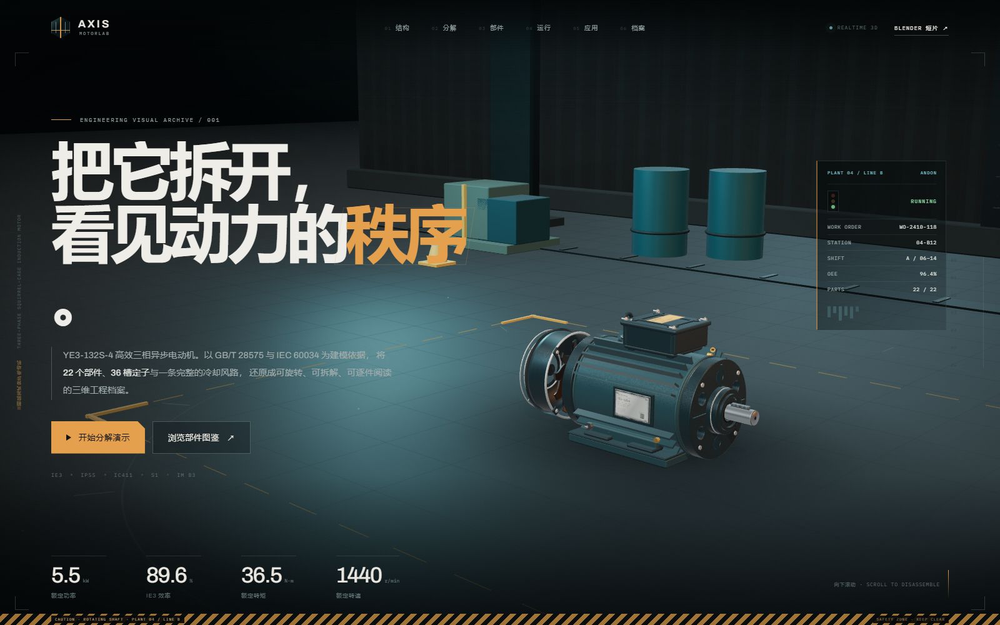

# AXIS MOTORLAB

**YE3-132S-4 三相异步电动机 · 交互式 3D 分解档案**

一个以 `Three.js` 构建的工业电机展示网站：程序化建模 22 个可独立拆解的部件，提供完整的滚动驱动分解动画、部件图鉴、X-RAY 运行原理可视化，以及依据公开标准与厂商样本整理的技术档案。

- **本地地址：** <http://127.0.0.1:5180/>
- **线上地址：** <https://axis-motorlab.pages.dev/>
- **Blender 短片：** <https://axis-motorlab.pages.dev/blender/>
- **GitHub：** <https://github.com/ML-2020/axis-motorlab>
- **机型：** YE3-132S-4 · 5.5 kW · 4 极 · 380 V / 50 Hz · IE3 · IP55 · IC411 · IM B3 · S1
- **建模依据：** GB/T 28575-2020、GB 18613-2020、GB/T 1032-2023、IEC 60034 / IEC 60072-1 等，以及 Wolong、WNM、Siemens 等公开样本。详见 [建模说明](docs/literature.md)。
- **站内说明页：** <http://127.0.0.1:5181/docs/literature.html>（UTF-8 HTML 版本，由 `scripts/build-literature.mjs` 生成）。



## 快速启动

```bash
npm install
npm run dev
```

打开 `http://127.0.0.1:5180/`。

生产构建：

```bash
npm run build
npm run preview   # http://127.0.0.1:5181/
```

> 当前工作区已安装依赖。若使用本机捆绑的 pnpm，可通过 `node <pnpm.mjs 路径> install` 安装。

## 页面结构

| 章节 | 内容 |
| --- | --- |
| `00 概览` | 整机 3D 舞台、额定参数、自动旋转、进入分解演示 |
| `01 结构` | 五类系统图例、模型热点、点击部件跳转档案 |
| `02 分解` | 460vh 滚动叙事（移动端 390vh），22 个部件按装配逻辑分离；四段式分镜；滑块、自动分解/装配、标注开关、部件标注引线 |
| `03 部件` | 22 部件索引、五类筛选、悬停/点击高亮、部件详情、上一件/下一件、聚焦相机 |
| `04 运行` | X-RAY 透视、旋转磁场示意、冷却风路粒子、转子运行、转速/转矩/效率/电流/温升遥测 |
| `05 应用` | 离心泵、皮带输送机、轴流风机三组应用场景模型与持续动画 |
| `06 档案` | 额定数据、铭牌、性能曲线、132S 安装尺寸工程图、文献来源及建模说明 |
| `07 产线档案` | 工厂产线状态、工单、OEE、班次、维护计划、资产条码与 ANDON 状态灯 |
| `08 Blender 短片` | 独立的 Blender 场景、7.5 秒爆炸动画、1920 静帧、工程包下载 → `/blender/` |

## Blender 短片

网站的主叙事是实时 Three.js 模型；`/blender/` 是同一台 YE3-132S-4 的另一条呈现路径：

- Blender 4.2 + EEVEE 独立场景，22 个命名部件；
- 7.5 秒装配→爆炸动画，1600 × 900、24 fps、H.264；
- 1920 × 1080 装配/爆炸静帧与四格分镜；
- 可下载完整工程包 `public/blender/AXIS_YE3_Blender_Scene.zip`（含 `.blend`、渲染、纹理、脚本和说明）；
- 入口：首页顶部 `BLENDER 短片 ↗` 或页面底部 `08 / BLENDER FILM` 卡片。

## 交互

- **滚动**：驱动章节和分解进度；分解章节中滚动会实时分解/装配模型。
- **自动演示**：点击首屏「开始分解演示」或分解章节的播放按钮。滚动、触摸或按键会中止自动播放，避免抢占控制。
- **滑块 / 分镜**：拖动滑块或点击四个阶段名称可跳转到对应分解程度。
- **标注**：桌面端显示部件引线标注，可点击跳转部件档案；移动端收起文字标注，点击模型或热点进入档案。
- **部件图鉴**：点击任意部件行或直接点击 3D 部件；选中部分会高亮并显示定位十字标；「聚焦部件」平滑推近相机。
- **运行原理**：运行/停机、X-RAY 开关；X-RAY 下机座、端盖、风扇罩等外壳材质变为幽灵材质，可见定子铁心、绕组、鼠笼、转轴、轴承与风路。
- **性能曲线与图纸**：移动端可横向滑动查看完整图表/图纸。

## 实现要点

- **程序化建模，不使用外部 glTF/图片贴图。** 22 个部件由 `BufferGeometry`、`ExtrudeGeometry`、`LatheGeometry`、`TubeGeometry` 与实例化网格生成。
- **真实结构细节：** 36 槽定子冲片（槽形轮廓由内圆开槽路径生成并叠片实例化）、28 槽铸铝鼠笼端环与斜导条、成型端部绕组、6308 深沟球轴承（外圈/内圈/9 颗钢球/黄铜保持架）、前后端盖通风孔、波形弹簧、轴伸油封、端子板 6 个 M8 柱与 Y/Δ 连接片、铭牌、吊环、散热筋与底脚孔等。
- **地面间隙修正：** 前后端盖外径从 138 mm 收至 127 mm，底部散热筋让出底脚区域；所有部件最低点不低于地面，修复前端盖低于地面的视觉穿插。
- **工厂 UI：** 首屏增加 PLANT 04 / LINE B 的工单、站位、班次、OEE、ANDON 状态灯和底部安全警示带；档案区增加产线记录表、维护计划和资产条码。
- **应用场景：** 新增 `05 / APPLICATIONS` 章节。程序化建模离心泵、皮带输送机和轴流风机三组周边设备；叶轮、风机转子、输送带、包装箱持续动画，并与主电机置于同一舞台。
- **工厂环境：** 主舞台加入卷帘门、钢结构立柱、屋顶梁、行车、工艺管线、桥架、配电柜、托盘、油桶、叉车、安全锥和地面安全作业区；环境在总览、结构、运行、应用章节显示，分解/部件/档案章节自动隐藏以保持结构阅读清晰。
- **动画：** 每个部件带独立的 `home / explode / delay / duration` 参数，按装配逻辑错峰分离；相机采用阻尼/缓动预设；滚动进度与滑杆双向绑定。
- **渲染：** ACES 色调映射、PMREM 室内环境反射、方向光阴影、程序化混凝土舞台、加性叠加的技术标注/风路/旋转磁场、CSS 网格与扫描噪点氛围。
- **性能：** 同材质子网格合并 + 实例化，桌面约 160 次 draw call / 42 万三角面；移动端关闭 3D 轨道控制以保留页面滚动手势。
- **响应式：** 1600/1366/1040/820/480 断点；移动端使用底部抽屉、横向部件索引、独立相机预设和简化标注。

## 目录

```
.
├─ index.html                 # 语义结构与页面文案
├─ src/
│  ├─ main.js                 # 应用控制器：章节、滚动、交互、遥测
│  ├─ style.css               # 设计系统与响应式布局
│  ├─ data/motor-data.js      # 额定数据、22 部件档案、曲线、尺寸、文献
│  ├─ model/
│  │  ├─ motor.js             # 22 部件装配、状态、拆解位置、拾取接口
│  │  ├─ frame.js             # 机座、端盖、轴承盖、风扇罩、吊环、铭牌
│  │  ├─ stator.js            # 定子铁心槽形叠片与定子绕组
│  │  ├─ rotor.js             # 转轴、转子铁心、鼠笼、内外风扇
│  │  ├─ support.js           # 6308 轴承、油封、波形弹簧、接线盒
│  │  ├─ applications.js      # 应用场景：离心泵、皮带输送机、轴流风机
│  │  ├─ materials.js         # 工业材质库与 X-RAY 幽灵材质
│  │  └─ utils.js             # 几何原语、螺栓实例、铭牌纹理
│  ├─ scene/stage.js          # 渲染器、相机预设、灯、材质、特效、拾取
│  ├─ scene/factory.js        # 工厂环境：墙体、钢结构、行车、管线与地面标线
│  └─ ui/
│     ├─ labels.js            # 部件引线标注、热点排布
│     ├─ parts.js             # 部件档案交互
│     └─ charts.js            # 性能曲线、尺寸图、遥测 sparkline
├─ docs/literature.md         # 工程设计说明与 12 项来源
├─ public/
│  ├─ docs/literature.html    # 站内 UTF-8 HTML 说明页（构建生成）
│  ├─ docs/literature.md      # 站内 Markdown 源文件（含 UTF-8 BOM）
│  ├─ blender/                # Blender 短片页、视频、静帧、工程包
│  ├─ robots.txt
│  ├─ sitemap.xml
│  └─ _headers               # Cloudflare Pages 缓存规则
└─ scripts/                   # 构建、Playwright 视觉与交互测试
```

> 本地 `blender/` 是 Blender 工作目录，不进入 Git；完整可编辑工程以 `public/blender/AXIS_YE3_Blender_Scene.zip` 发布。

## 数据说明

- 页面中的安装尺寸、性能曲线和部件参数用于工程可视化与教学展示，**不构成制造图纸或验收依据**。
- 厂商样本间存在差异（总长 444～510 mm、质量 69～72 kg、电流 11.2～11.6 A 等），页面取代表性典型值，并在 [docs/literature.md](docs/literature.md) 中列出取舍。
- 性能曲线为 5.5 kW / 4 极 IE3 机型的代表性曲线，取自标准换算与样本对照，不是某一批次的出厂试验数据。
- 转子槽数在多数样本为 28 槽，部分设计为 32 槽；本模型采用 28 槽以匹配可视化结构。

## 验证

- `npm run build` 通过（Vite）。
- Playwright 交互回归 18/18 通过：加载、自动分解、滑块、标注开关、标注跳转部件、部件高亮、聚焦、运行/停止、X-RAY、曲线渲染、无水平溢出、无控制台错误。
- 3D 地面间隙检查：前端盖/后端盖最低点 `+0.0028 m`，定子机座底脚 `0.0000 m`，无部件穿地。
- 应用章节检查：桌面 1600 与移动 390 下三个场景模型正常显示、持续动画，无控制台错误、无横向溢出。
- 工厂环境检查：墙体、设备、地面标线正常；分解/部件章节自动隐藏环境，不遮挡结构。
- 已检查 `1600×960`、`1366×768`、`390×844` 视口和 `prefers-reduced-motion` 环境。
- `/blender/` 页面视频可播放（readyState 4 / 7.5 s），工程包与静帧均可下载。
- Cloudflare Pages 生产部署已验证 200：首页、Blender 页、MP4、ZIP、sitemap、robots。

运行回归测试（需要本机 Chrome，且先启动 `npm run dev`）：

```bash
npm run test:e2e
```

## 部署

### Cloudflare Pages

```bash
npm run build
npx wrangler pages deploy dist --project-name axis-motorlab --branch main
```

构建产物在 `dist/`；Cloudflare Pages 会自动识别 `public/_headers`、`robots.txt` 与 `sitemap.xml`。

### GitHub

仓库以 `main` 为生产分支，`dist/`、`node_modules/` 与本地 Blender 工作目录不提交。

```bash
gh repo create ML-2020/axis-motorlab --public --source=. --remote=origin --push
```

## 说明

本项目的三维模型为工程可视化重建，而非 CAD 制造模型。实际电机设计在槽配合、绕组节距、轴承布置、通风结构等方面会因制造商与具体批次而变化。
