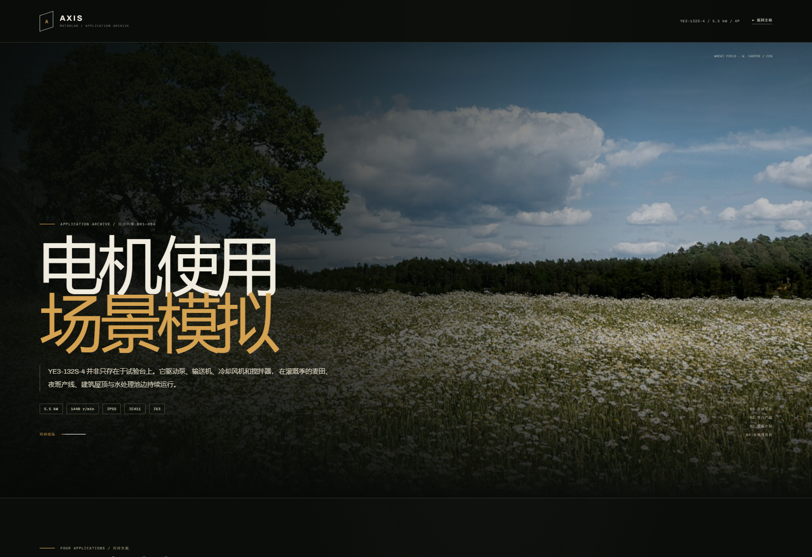

# AXIS MOTORLAB

YE3-132S-4 三相异步电动机 · 交互式三维工程档案与应用场景档案。

- 主站：<https://axis-motorlab.pages.dev/>
- 应用场景档案：<https://axis-motorlab.pages.dev/scenarios/>
- Blender 短片：<https://axis-motorlab.pages.dev/blender/>
- GitHub：<https://github.com/ML-2020/axis-motorlab>
- 机型：YE3-132S-4 · 5.5 kW · 4 极 · 380 V / 50 Hz · IE3 · IP55 · IC411 · IM B3 · S1
- 建模依据：GB/T 28575-2020、GB 18613-2020、GB/T 1032-2023、IEC 60034 / IEC 60072-1 等公开标准，以及 Wolong、WEG、Siemens 等公开样本。详见 [建模说明](docs/literature.md)。


## 主站

主站以 Three.js 程序化重建 22 个可独立拆解的三维部件，包含：

- 36 槽定子、28 槽铸铝鼠笼、端部绕组、6308 轴承、端盖、风扇、接线盒与铭牌；
- 滚动驱动的整机分解/装配动画、四段式分镜、滑块与自动演示；
- 22 部件档案、分类筛选、模型拾取、高亮、聚焦相机与 X-RAY 运行原理；
- 应用场景模型、工厂环境、产线档案、性能曲线、安装尺寸图；
- `/blender/` 独立 Blender 场景、爆炸短片、静帧和工程包下载。

## 应用场景档案

`/scenarios/` 是与主站叙事分开的独立页面，以 **“电机使用场景”** 为主题。现场照片用于识别设备结构与比例，前景设备由 Three.js 数字模型重建；每张卡片右上角保留参考缩略图，避免把实拍照片当成 3D 场景。

四张场景卡在同一页面并列展示，四个模型和相机同时渲染：

1. **麦田泵站**：绿色离心泵、黑色散热筋电机、联轴器护罩、压力表与泵组底座；
2. **室内产线**：蓝色滚筒输送机、驱动侧电机/减速机构、包装箱与输送带运动；
3. **屋顶冷却**：方形冷却塔、圆形风机护罩、格栅与旋转叶轮；
4. **水处理搅拌**：圆形处理池、中心驱动、旋转桥架、刮臂与水面。

四张卡同时保留持续模型动画、缓推镜头、流动路径、脉冲热点和工艺读数，页面主题明确为电机应用，而不是“天气与时间”。

场景环境由可复用的模块化资产搭成：泵房墙体/管道/电缆桥架、厂房墙体/窗带/桁架/货架、屋顶女儿墙/机组/栏杆、处理池平台/控制房/湿地植被。地面、墙面、板材使用程序化纹理，模型使用方向光阴影与接触阴影。



### 图片授权

场景照片来自 Wikimedia Commons，页面内保留来源与授权链接：

- [泵组 · Bitjungle / CC BY-SA 4.0](https://commons.wikimedia.org/wiki/File:Centrifugal_pumps.jpg)
- [输送线 · falco / CC0](https://commons.wikimedia.org/wiki/File:Conveyor_system_in_a_factory.jpg)
- [冷却塔风机 · Steve Johnson / CC BY 2.0](https://commons.wikimedia.org/wiki/File:Cooling_tower_fan.jpg)
- [水处理池 · Saiphani02 / CC BY-SA 4.0](https://commons.wikimedia.org/wiki/File:Krishnapuram_water_treatment_plant_tank.jpg)
- [麦田 · W.carter / CC0](https://commons.wikimedia.org/wiki/File:Tree_and_wheat_field_in_R%C3%B6e_1.jpg)

工程布置参考泵、输送机、冷却塔风机和水处理搅拌机的典型安装资料：

- [Goulds 泵安装与运行手册](http://www.gouldspumps.com/ittgp/medialibrary/goulds/website/Literature/Instruction%20and%20Operation%20Manuals/Alphabetical/IOM-ICM-ICMP-en-us-2024-02_A4.pdf)
- [输送机驱动系统专利](https://patents.google.com/patent/US6817467B2/en)
- [冷却塔风机驱动专利](https://patents.google.com/patent/US20230018836A1/en)
- [侧入式搅拌机安装资料](https://m.china-mcc.com/prod_show-140639.html)

画面是解释性应用模拟，不替代施工图、现场测量或选型计算。

## 运行

```bash
npm install
npm run dev
```

- 本地主站：<http://127.0.0.1:5180/>
- 本地应用场景档案：<http://127.0.0.1:5180/scenarios/>

生产构建：

```bash
npm run build
npm run preview   # http://127.0.0.1:5181/
```

部署：Cloudflare Pages 项目 `axis-motorlab`，`dist/` 直接上传。

## 目录

```
.
├─ index.html                    # 主站单页叙事
├─ src/
│  ├─ model/                     # 22 个程序化部件、应用模型、材质
│  ├─ scene/                     # 舞台、相机、灯、工厂环境
│  ├─ data/                      # 机型、部件、应用与文献数据
│  └─ scenarios/                 # 应用场景档案：photo.js / photo.css
├─ scenarios/index.html          # /scenarios/ 页面
├─ public/
│  ├─ media/applications/        # 授权场景照片
│  ├─ blender/                   # Blender 短片页、视频、静帧、工程包
│  ├─ docs/                      # 建模说明
│  └─ sitemap.xml
├─ vite.config.js                # 主站 + /scenarios/ 多页面构建
└─ scripts/                      # 构建与 Playwright 回归测试
```

## 验证

- Playwright 交互回归：18/18 通过；
- 主站桌面/移动端无控制台错误、无横向溢出；
- `/scenarios/` 四张场景卡、五张授权图片正常加载；
- 移动端 390 px 无横向溢出；
- Cloudflare Pages 生产地址可访问。
