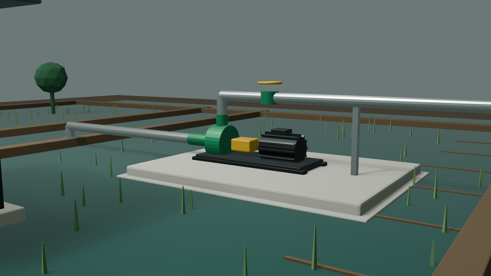

# 稻田灌溉泵站 v2 · 预演图元素识别

## 1. 选定预演

- 图：`docs/concepts/paddy-v2-previs-03.png`
- Blender 文件：`blender/previs/paddy_v2_previs.blend`
- 用途：只用于确认空间、镜头、光位和资产清单，不是最终渲染。

## 2. 镜头与灯光

| 项目 | 预演值 | 备注 |
|---|---|---|
| 相机 | 35 mm | 接近人眼叙事，不用广角畸变 |
| 机位高度 | 1.58 m | 站在田埂上的视角 |
| 机位 | 右前方 3/4 | 能看到泵组、吸入管、出口管 |
| 目标点 | 泵组中心偏上 | 泵组占画面中下部 |
| 主光 | 右后上方柔和太阳 | 阴天/清晨方向，不硬 |
| 环境光 | 冷灰天空 | 湿泥和水面有弱反射 |
| 色调 | AgX Medium High Contrast | 避免死黑和塑料高光 |

### 预演暴露的问题

1. 泵组仍偏小，前景水田占比过大；
2. 泵、电机、底座仍是代理几何，不能作为最终资产；
3. 管道缺少弯头、法兰、支架的真实结构；
4. 出口管横跨太长，画面右侧被管道切掉；
5. 棚架在画面边缘，空间关系不完整；
6. 稻株只是锥体，不能用于最终；
7. 水面没有反射、浑浊层次和岸边湿痕；
8. 天空是纯色，缺少环境光方向。

## 3. 从图中识别的 3D 资产

### A. 空间/环境

| 编号 | 元素 | 图中位置 | 处理 |
|---|---|---|---|
| ENV-01 | 水田 | 前景/背景 | 水面材质 + 泥底 + 浅水透明 |
| ENV-02 | 田埂 | 横纵分隔 | 不规则泥埂 + 草皮 + 水蚀 |
| ENV-03 | 灌渠 | 左侧 | 渠底、渠壁、水面、湿泥 |
| ENV-04 | 稻株 | 水田中 | Geometry Nodes/实例化 |
| ENV-05 | 杂草 | 田埂边缘 | 散布 |
| ENV-06 | 棚架 | 左后方 | 钢管、屋顶、斜撑、锈蚀 |
| ENV-07 | 树线 | 远景 | 低模/ impostor |
| ENV-08 | 天空 | 背景 | HDRI 或物理天空 |
| ENV-09 | 电缆 | 电机接线 | 电缆桥架/穿线管/接线盒 |

### B. 土建

| 编号 | 元素 | 图中位置 | 处理 |
|---|---|---|---|
| CIV-01 | 混凝土泵台 | 中景 | 倒角、排水坡、预埋螺栓 |
| CIV-02 | 泵台基础 | 泵台下 | 垫层、二次灌浆 |
| CIV-03 | 排水沟 | 泵台低侧 | 沟槽、格栅 |
| CIV-04 | 检修通道 | 泵台周围 | 宽度、防滑 |

### C. 泵组

| 编号 | 元素 | 图中位置 | 处理 |
|---|---|---|---|
| P-01 | 公共底座 | 泵组下 | 槽钢、安装板、地脚孔 |
| P-02 | 泵蜗壳 | 中部 | 真实端吸泵外形、法兰 |
| P-03 | 吸入口 | 左侧 | DN 法兰、螺栓 |
| P-04 | 出口 | 上方 | DN 法兰、止回阀、闸阀 |
| P-05 | 泵脚 | 泵体下 | 与底座贴合 |
| P-06 | 轴承体 | 泵与联轴器之间 | 轴承座、轴封 |
| P-07 | 联轴器 | 泵/电机之间 | 两半、弹性件、护罩 |
| P-08 | 电机 | 右侧 | **主站 22 部件 Three.js Motor** |
| P-09 | 压力表 | 出口管 | 表弯、表盘、接头 |
| P-10 | 排气/排水 | 泵体 | 小阀、堵头 |

### D. 管路

| 编号 | 元素 | 图中位置 | 处理 |
|---|---|---|---|
| PIP-01 | 吸入管 | 左到渠 | 弯头、法兰、支架 |
| PIP-02 | 滤网 | 渠内 | 网笼、提绳/吊耳 |
| PIP-03 | 出口立管 | 泵出口 | 法兰、止回阀 |
| PIP-04 | 出口横管 | 右向田间 | 弯头、支架、坡度 |
| PIP-05 | 管道支架 | 横管下 | 鞍座、U 型卡、基础 |
| PIP-06 | 阀门 | 出口 | 闸阀/止回阀 |
| PIP-07 | 压力表弯 | 出口 | 表弯、针型阀 |

### E. 环境细节

| 编号 | 元素 | 处理 |
|---|---|---|
| DET-01 | 湿泥脚印 | 贴图/置换 |
| DET-02 | 水渍 | 材质粗糙度变化 |
| DET-03 | 锈迹 | 金属边缘/螺栓 |
| DET-04 | 油污 | 泵/电机底部 |
| DET-05 | 杂草 | 散布资产 |
| DET-06 | 水面漂浮物 | 少量几何/贴图 |

## 4. 资产优先级

### 第一优先

1. 泵组（P-01 到 P-07）；
2. 管路（PIP-01 到 PIP-05）；
3. 泵台与基础（CIV-01、CIV-02）；
4. 电机通过锚点接入；
5. 镜头和灯光锁定。

### 第二优先

1. 田埂与水面；
2. 稻株/杂草；
3. 棚架和树线；
4. 环境细节。

### 第三优先

1. HDRI/天空；
2. 水面反射与浑浊层次；
3. 远景 LOD；
4. 移动端性能。

## 5. 下一轮预演要调整

- 相机前移约 0.8–1.2 m，泵组占画面更大；
- 出口管改为向画面右后方走，不横切主体；
- 棚架移到左后方完整入画；
- 水面/田埂增加粗糙度和湿反射；
- 天空换成阴天 HDRI，不再纯色；
- 增加电机电缆和接线盒；
- 增加泵台排水沟和检修空间。

## 6. 资产来源

| 类型 | 来源 |
|---|---|
| 环境纹理 | Poly Haven CC0 |
| 水面/泥 | Poly Haven CC0 + Blender 材质 |
| 稻株/杂草 | Blender Geometry Nodes 或 CC0 植被 |
| 电机 | 主站 `src/model/motor.js` |
| 泵/阀/管件 | 制造商 CAD 或按标准手工建 |
| 载入/装配 | Three.js + GLB + Anchor |

## 7. 结论

预演已经证明：

- 空间关系可以成立；
- 35 mm 人眼视角可用；
- 但当前资产等级仍然是 **Technical Blockout**。

下一步不能直接“美化预演”，而要按清单把泵组、管路、泵台替换成 Mechanical Accurate Mockup，再重新布光和构图。
