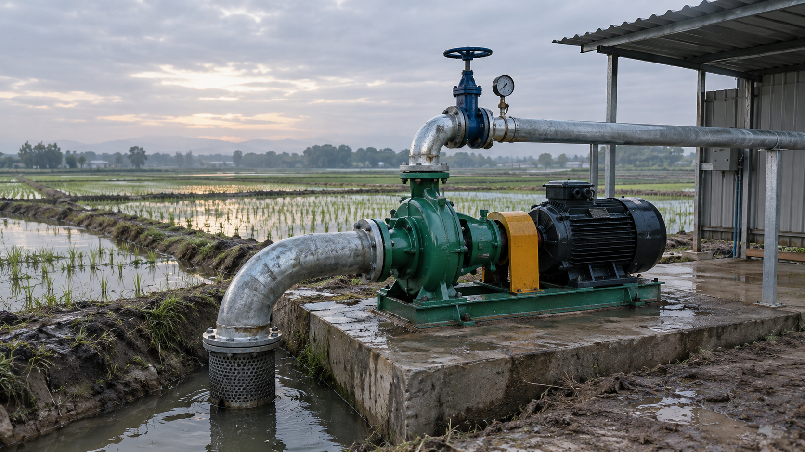

# 稻田灌溉泵站 v3 · GPT 参考图分析

## 1. 参考图

- 图源：用户提供的 GPT 生成图；
- 用途：空间、构图、设备关系参考；
- **不上网站、不进入 `public/`、不作为贴图**；
- 实际尺寸、法兰、轴系仍以机械约束为准。

## 2. 画面判断

### 镜头

- 约 35–40 mm 等效；
- 机位高度约 1.4–1.6 m；
- 3/4 前侧，泵组位于画面中右，吸入口朝左前方；
- 背景水田占左侧，棚架和电控箱在右侧；
- 地平线偏低，天空留出约上 1/4。

### 光线

- 清晨低角度暖光，阴云/薄雾；
- 主光从左后方穿过天空，水面有弱反射；
- 泵组正面处于柔和阴影；
- 湿混凝土和泥地有高光，不要镜面。

### 构图

- 前景：灌渠、吸入口滤网、湿泥；
- 中景：绿色泵组、黑色电机、黄色护罩、混凝土泵台；
- 右侧：棚架、波纹墙、电控箱；
- 背景：水田、田埂、树线、低山、晨空。

## 3. 图中的资产

### 泵组

| ID | 元素 | 图中特征 | 建模注意 |
|---|---|---|---|
| P-01 | 卧式端吸泵 | 绿色蜗壳，左吸入口，上出口 | 蜗壳、泵脚、法兰、轴封 |
| P-02 | 电机 | 黑色散热筋，右侧 | 与主站 22 部件 Motor 一致 |
| P-03 | 联轴器护罩 | 黄色 | 不碰旋转件，带固定螺钉 |
| P-04 | 公共底座 | 绿色型钢 | 泵脚/电机脚贴合，地脚螺栓 |
| P-05 | 吸入口 | 左侧大弯头 | 法兰、螺栓、弯头 |
| P-06 | 出口 | 上部立管 + 弯头 | 止回阀、闸阀、压力表 |
| P-07 | 闸阀 | 蓝色阀体/手轮 | 阀杆、阀盖、法兰 |
| P-08 | 压力表 | 出口立管旁 | 表弯、表盘、接头 |
| P-09 | 吸入滤网 | 渠内圆筒网 | 网孔、吊耳、法兰 |

### 土建/环境

| ID | 元素 | 图中特征 | 建模注意 |
|---|---|---|---|
| C-01 | 混凝土泵台 | 湿混凝土，边缘破损 | 倒角、水渍、排水坡 |
| C-02 | 灌渠 | 左下，泥水 | 渠壁、湿泥、水面 |
| C-03 | 田埂 | 水田分隔 | 不规则泥埂、草 |
| C-04 | 水田 | 左侧/背景 | 浅水、稻株、反射 |
| C-05 | 棚架 | 右侧 | 波纹板、方管柱、电控箱 |
| C-06 | 树线/低山 | 远景 | LOD/impostor |
| C-07 | 天空 | 晨云/暖光 | HDRI 或物理天空 |

## 4. 图里需要修正的工程问题

这是一张生成图，不是施工图。建模时不能照抄以下地方：

1. **泵和电机的相对高度**：必须回到 132S 轴高 132 mm；
2. **联轴器长度/护罩间隙**：按实际联轴器；
3. **出口阀顺序**：泵 → 止回阀 → 闸阀 → 压力表，图里只能作参考；
4. **法兰螺栓数量/孔距**：按标准；
5. **泵脚与底座接触**：不能悬空；
6. **吸入口滤网**：必须低于最低水位，且可拆；
7. **管道支架**：出口横管需要支吊架，不能只靠弯头；
8. **电控箱/电缆**：需要进线管、接地、检修空间；
9. **棚架与泵组检修空间**：不能阻挡盘车和拆联轴器；
10. **水面/泥地**：不要做成镜面，保持浑浊和湿痕。

## 5. 资产优先级

### 第一优先

1. 泵组：P-01 到 P-06；
2. 管路/阀门/仪表：P-05 到 P-09；
3. 泵台/基础；
4. 电机通过 `Anchor_Motor_Mount` 接入；
5. 镜头/光位。

### 第二优先

1. 灌渠、田埂、水田；
2. 棚架、电控箱；
3. 树线、低山、天空。

### 第三优先

1. 稻株、杂草；
2. 水渍、泥痕、锈迹；
3. 远景 LOD、移动端优化。

## 6. 新场景构建原则

- 不在 Three.js 里补泵/阀/管；
- 泵组在 Blender 中完成，GLB 导出；
- 电机保持主站 Three.js Motor；
- 参考图只用于形态与构图，不参与尺寸；
- 先做 Mechanical Accurate Mockup，再做 PBR/细节；
- 新页面替换旧 `/scenarios/`，旧版归档。

## 7. 下一步

1. 按本图重设相机：35 mm、1.5 m、3/4 角度；
2. 重做泵组和管路 blockout；
3. 建立 `Anchor_Motor_Mount`；
4. 替换材质：湿混凝土、泥、绿色铸件、镀锌管、黑色电机；
5. 布光：晨光 + 阴天环境光；
6. 渲染对照图；
7. 通过后导出 GLB，接回页面。
