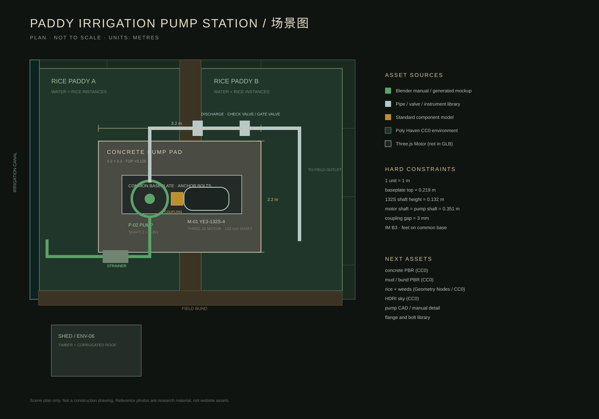

# 稻田灌溉泵站 · 场景图与资产拆分

## 1. 先做场景图，不先做模型

这一步只定义：

- 场地范围；
- 设备位置；
- 管路走向；
- 检修通道；
- 相机主视角；
- 每个物体用什么资产来源。

不在这阶段写 Three.js 几何体，也不在 Blender 里即兴堆盒子。



## 2. 场地平面

坐标原点：泵组公共底座中心投影点。

| 区域 | 范围 | 说明 |
|---|---|---|
| 稻田 A | 西侧 8 m × 10 m | 浅水、稻株、田埂 |
| 稻田 B | 东侧 7 m × 10 m | 与 A 由田埂分隔 |
| 灌渠 | 西侧，宽 1.2 m | 吸入滤网沉入渠内 |
| 泵台 | 3.2 m × 2.2 m | 混凝土，顶面 +0.12 m |
| 泵组底座 | 1.6 m × 0.6 m | 槽钢公共底座 |
| 出口管 | 向东 3.5 m | 止回阀、闸阀、压力表 |
| 棚架 | 西北角 | 2.4 m × 1.7 m |
| 主视角 | 东南向西北 | 看到泵组、出口管、稻田层次 |

## 3. 机械基准

```text
泵台顶面              Z = 0.120 m
公共底座安装面        Z = 0.219 m
132S 轴高             H = 0.132 m
电机轴心              Z = 0.351 m
泵轴心                Z = 0.351 m
联轴器轴向间隙        3 mm
```

硬约束：

- 电机底脚与公共底座安装面贴合；
- 电机轴心与泵轴心共线；
- 电机通过 `Anchor_Motor_Mount` 定位；
- 泵组不通过 Three.js 临时几何体补件。

## 4. 场景图需要的资产

### 4.1 环境资产

| ID | 资产 | 来源建议 | 许可证 | 处理方式 |
|---|---|---|---|---|
| ENV-01 | 稻田浅水 | Blender 水面 + 法线 | 自制 | Blender 材质 |
| ENV-02 | 田埂泥土 | Poly Haven `aerial_mud_1` 或同类 PBR | CC0 | 贴图 + displacement |
| ENV-03 | 稻株 | Blender Geometry Nodes 或 CC0 植物 | CC0/自制 | 实例化 + 风动 |
| ENV-04 | 杂草 | Poly Haven 植物资产 | CC0 | 散布 |
| ENV-05 | 天空/HDRI | Poly Haven HDRI | CC0 | Three.js environment |
| ENV-06 | 棚架 | Blender 手工 | 自制 | 锈蚀金属材质 |
| ENV-07 | 树木 | Poly Haven 树木或自制 | CC0/自制 | 远景 LOD |

### 4.2 土建资产

| ID | 资产 | 来源 | 说明 |
|---|---|---|---|
| CIV-01 | 混凝土泵台 | Blender 手工 | 倒角、排水坡、预埋螺栓 |
| CIV-02 | 排水沟 | Blender 手工 | 泵台低侧 |
| CIV-03 | 地脚螺栓/垫铁 | Blender 手工 | 与底座孔位对应 |

### 4.3 泵组资产

| ID | 资产 | 来源 | 说明 |
|---|---|---|---|
| P-01 | 公共底座 | Blender 手工 | 槽钢/铸铁，找平垫铁 |
| P-02 | 卧式端吸泵 | 制造商 CAD 或手工 | 蜗壳、吸入口、出口、泵脚 |
| P-03 | 泵轴/轴承体 | 同 P-02 | 与电机轴对中 |
| P-04 | 联轴器 | 标准件模型/手工 | 两半 + 弹性件 |
| P-05 | 联轴器护罩 | Blender 手工 | 不碰旋转件，带固定螺钉 |
| P-06 | 闸阀 | 标准阀门模型/手工 | 阀体、阀盖、阀杆、手轮 |
| P-07 | 止回阀 | 标准件/手工 | 出口管路上 |
| P-08 | 压力表 | 标准件/手工 | 表弯、表盘、接头 |
| P-09 | 吸入滤网 | Blender 手工 | 沉入灌渠 |
| P-10 | 管道/法兰/弯头 | 管件库或手工 | 法兰螺栓组 |

### 4.4 电机

| ID | 资产 | 来源 | 说明 |
|---|---|---|---|
| M-01 | YE3-132S-4 | 主站 `src/model/motor.js` | 不进入 GLB，不在 Blender 重建 |

## 5. Blender 组装顺序

1. 建立单位：1 unit = 1 m；
2. 导入/制作土建泵台；
3. 放置公共底座和地脚螺栓；
4. 放泵体、泵脚、轴心；
5. 放联轴器和护罩；
6. 放电机 proxy，确认 132 mm 轴高；
7. 生成 `Anchor_Motor_Mount`；
8. 放管道、阀门、仪表、支架；
9. 放环境资产；
10. 导出 GLB，保留锚点；
11. Three.js 加载 GLB，实例化主站 Motor。

## 6. 当前不做的事

- 不使用 Three.js 的 Box/Cylinder 代替泵、阀、管道；
- 不把电机静态导入 GLB；
- 不把 Sketchfab 上未确认授权的模型直接放进仓库；
- 不把参考照片当纹理；
- 不把 Technical Blockout 说成 Production Asset。

## 7. 下一步

1. 用 Poly Haven CC0 纹理替换混凝土、泥、水面材质；
2. 用 Blender 手工补泵壳、法兰、螺栓、阀门、支架；
3. 用 Geometry Nodes 或 CC0 植被升级稻株；
4. 重新导出 GLB；
5. Three.js 保留锚点和交互，统一 HDRI 和阴影。
